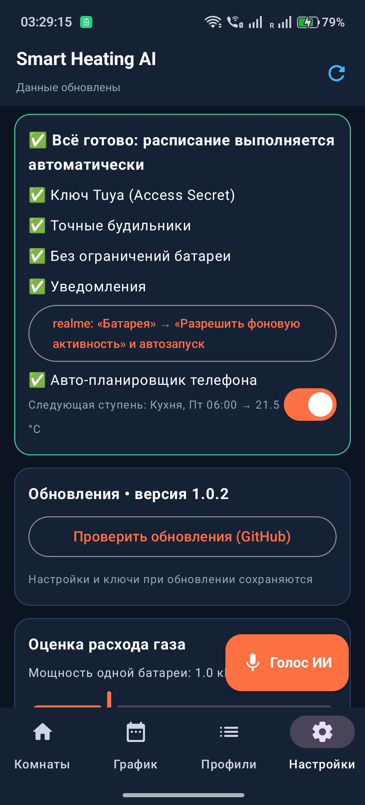

# Установка и первый запуск

## 1. Скачать APK на телефон
1. На телефоне откройте **[страницу последней версии](https://github.com/ivankoval921-bit/smartheating-ai-releases/releases/latest)**.
2. В разделе **Assets** нажмите `SmartHeatingAI_<версия>.apk`, файл скачается.
3. Откройте скачанный файл. Если Android спросит **«Разрешить установку из этого источника?»**, включите переключатель для браузера и вернитесь назад.
4. Нажмите **«Установить»**. Если появится Google Play Protect с вопросом «Неизвестное приложение», выберите «Всё равно установить»: приложение не из магазина, это нормально.

> Требования: Android 8.0 и новее. Проверено на realme GT 7 (Android 16).

**С компьютера по USB** (для тех, кто умеет):
```
adb install -r SmartHeatingAI_1.0.1.apk
```

## 2. Подключить облако Tuya
Если ключей ещё нет, сначала пройдите **[TUYA_SETUP.md](TUYA_SETUP.md)**: регистрация, около 15 минут.

Дальше в приложении откройте вкладку **Настройки** → карточку «Облако Tuya»:
| Поле | Что вставить |
|---|---|
| Endpoint | `https://openapi.tuyaeu.com` (для Европы) |
| Access ID / Client ID | из проекта Tuya → Overview |
| Access Secret | оттуда же (значок глаза → копировать) |
| Tuya App UID | Devices → Link Tuya App Account → колонка UID |

Нажмите **«Сохранить ключи и проверить связь»**. Через 5–10 секунд во вкладке «Комнаты» появятся температуры. Ключ шифруется и хранится только на телефоне.



## 3. Проверка готовности (обязательно, 1 минута)
Вверху вкладки **Настройки** есть карточка **«Проверка готовности»**. Все пункты должны стать ✅:
- **Ключ Tuya**: сохранён (пункт 2).
- **Точные будильники**: на Android 13+ включаются автоматически.
- **Без ограничений батареи**: нажмите «Разрешить» → «Разрешить». **Без этого realme/OPPO/Xiaomi усыпляют приложение, и ступени пропускаются.**
- **realme / ColorOS** (кнопка внизу карточки): «Батарея» → **«Разрешить фоновую активность»**, а также **«Автозапуск»**, если такой пункт есть.
- **Уведомления**: разрешить.
- **Авто-планировщик телефона**: включить переключатель.

## 4. Голос без интернета (рекомендуется)
Чтобы голос работал и без сети, скачайте офлайн-пакет распознавания:
**Настройки телефона → Google → Все сервисы → Голосовой ввод (или «Распознавание речи») → Распознавание офлайн → Русский** (и **Украинский**). На части прошивок этот пункт называется «Языки офлайн-распознавания».

## 5. Виджет и ярлык
- **Настройки → «Добавить виджет на рабочий стол»**: температуры комнат прямо на экране.
- Долгое нажатие на значок приложения → **«Голос (ИИ)»**: сразу открывает микрофон.

## 6. Обновления
**Настройки → Обновления → «Проверить обновления (GitHub)»**. Если есть новая версия, нажмите «Скачать и установить». Один раз Android попросит разрешить «Установку неизвестных приложений» для Smart Heating AI. Ключи, расписания и профили при обновлении **сохраняются**.
