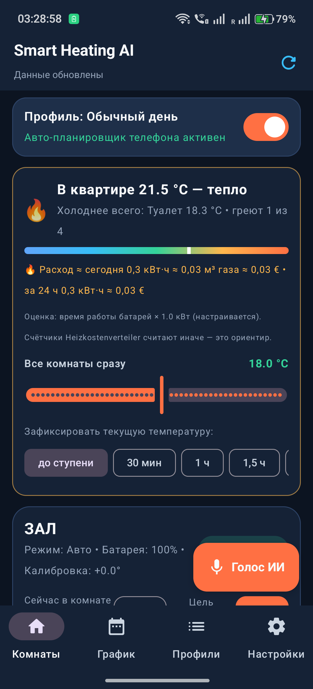
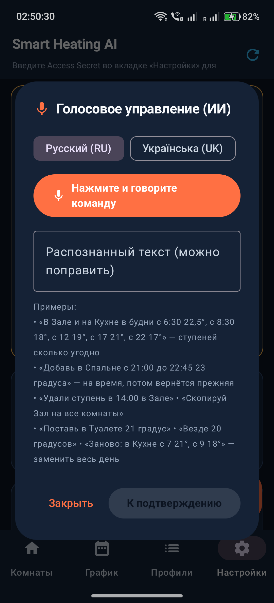
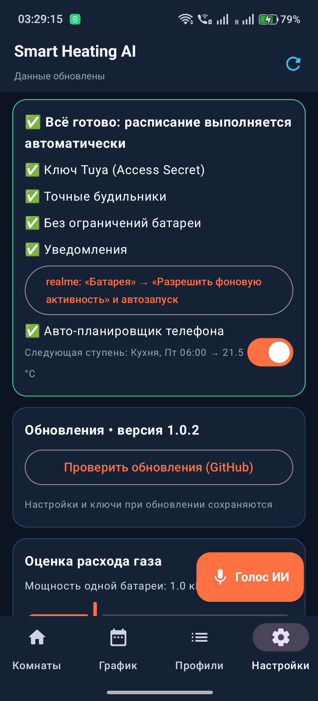

# Smart Heating AI 🔥

Android-приложение для управления радиаторными термостатами **Tuya / Smart Life** (проверено на WiFi Smart TRV Ecogaz XR806) через облако **Tuya Cloud OpenAPI**. Работает с телефона, компьютер для этого не нужен.

**Главное отличие от обычного приложения Tuya:** в сутки можно задать **сколько угодно ступеней** (12, 20, 24, 30 и больше), а не 6.

| Комнаты и бегунки | Голосовое управление | Проверка готовности |
|---|---|---|
|  |  |  |

---

## Что умеет

- **Неограниченные ступени расписания.** Все ступени выполняет телефон, точно по времени (Europe/Berlin, с учётом перехода на летнее и зимнее время). Шесть самых важных ступеней дополнительно записываются в память самого термостата как страховка на случай, если пропадёт интернет.
- **Готовые шаблоны с 00:00**: 12 ступеней (каждые 2 часа), 20 (подробный день), 24 (каждый час), 30 (включение и притушивание импульсами). Шаблоны находятся во вкладке «Профили».
- **Бегунки («реостаты»).** У каждой комнаты свой бегунок, плюс **общий бегунок «Все комнаты сразу»**. Значение держится до следующей ступени, потом комната сама возвращается в авторежим.
- **Фиксация** на 30 мин, 1 ч, 1,5 ч, 2 ч или 3 ч. Пока фиксация действует, ступени расписания температуру не меняют. Когда время выйдет, включается авторежим.
- **Голос на русском и украинском**, работает и без интернета: распознавание идёт прямо на телефоне, команды разбираются локально.
  - «В Зале с 6:30 22,5°, с 8:30 18°, с 12 19°, с 17 21°, с 22 17°»: столько ступеней, сколько назовёте;
  - «Добавь в Спальне с 21:00 до 22:45 23 градуса»: на время, потом вернётся прежняя температура;
  - «Удали ступень в 14:00 в Зале», «Скопируй Зал на все комнаты», «Везде 20 градусов».
  - Перед отправкой всегда показывается предпросмотр, и вы подтверждаете команду.
- **Наглядность.** 🔥 анимация, пока батарея греет; ✅ батарея нагрела до цели; ❄️ почти холодная; 🪟 окно открыто. Сверху сводка «В квартире 19,8 °C — комфортно» с цветной шкалой.
- **Защита от проветривания.** При резком похолодании (−1,2 °C за 15 мин) отопление ставится на паузу, приходит уведомление, через заданное время отопление возвращается.
- **Уведомления** о холоде в комнате, низком заряде батареек и сбоях доставки команд.
- **Надёжная доставка.** Каждая команда проверяется по фактическому состоянию термостата. Если комната со слабым Wi-Fi не ответила, команда повторяется отдельным будильником.
- **Экономия лимита Tuya.** Все 4 комнаты читаются одним запросом.
- **Самообновление.** «Настройки → Обновления → Проверить обновления» скачивает новую версию с GitHub и ставит её поверх старой. Ключи и настройки при этом сохраняются.

## Документы

| Файл | Для кого | Что внутри |
|---|---|---|
| [INSTALL.md](INSTALL.md) | человек | Установка на телефон и первый запуск |
| [TUYA_SETUP.md](TUYA_SETUP.md) | человек | Регистрация в облаке Tuya: где взять ключи, со ссылками |
| [USER_GUIDE.md](USER_GUIDE.md) | человек | Как пользоваться: ступени, бегунки, фиксация, голос, шаблоны |
| [TROUBLESHOOTING.md](TROUBLESHOOTING.md) | человек | Если что-то не работает |
| [AI_SETUP.md](AI_SETUP.md) | любой ИИ-агент | Универсальная пошаговая инструкция для подключения |
| [CHANGELOG.md](CHANGELOG.md) | все | Что изменилось в версиях |

## Скачать

Последняя версия: **[github.com/ivankoval921-bit/smartheating-ai-releases/releases/latest](https://github.com/ivankoval921-bit/smartheating-ai-releases/releases/latest)**, файл `SmartHeatingAI_<версия>.apk`.

Автор: Volodymyr Ilchenko. Приложение бесплатное, для личного использования. Ключи доступа к Tuya хранятся только на вашем телефоне (Android Keystore, AES-256-GCM). В APK их нет.
