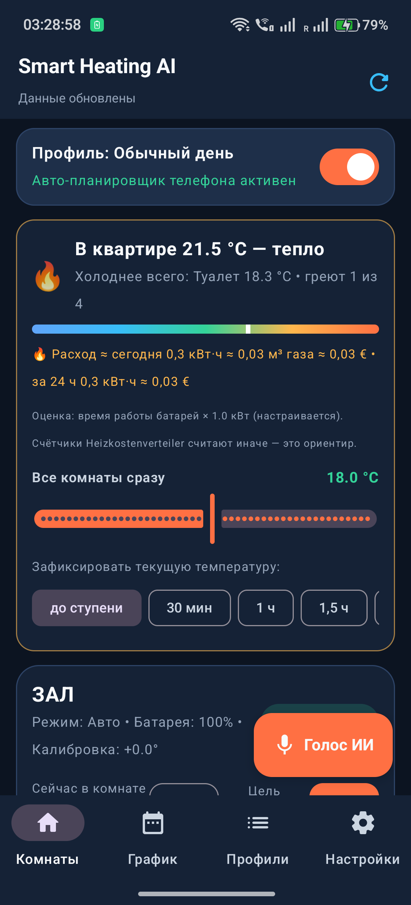

# Как пользоваться Smart Heating AI

## Вкладка «Комнаты»

**Сводка квартиры** (верхняя карточка): средняя температура воздуха и оценка (холодно / прохладно / комфортно / тепло / жарко), самая холодная комната, сколько батарей сейчас греют, цветная шкала 14…26 °C.

**Общий бегунок «Все комнаты сразу»**: передвиньте и отпустите, температура ставится на всех 4 батареях одновременно.

**Карточка комнаты**:
| Значок | Значение |
|---|---|
| 🔥 (мигает) | батарея греет, клапан открыт |
| ✅ | батарея нагрела комнату до цели |
| ♨️ | тёплая, ждёт |
| ❄️ | цель ≤ 16 °C, батарея почти холодная |
| 🪟 | окно открыто, отопление на паузе |
| ⚪ | нет связи с термостатом |

- **Бегунок «Ручной режим»**: двигаете пальцем и отпускаете. Команда уходит один раз, в момент отпускания. Под бегунком написано, до какого времени держится значение, например «Держится до 17:30, затем авторежим: 21 °C».
- **Кнопки −0.5° / +0.5°**: точная подстройка.
- **Фиксация** (ряд кнопок под бегунком):
  - «до ступени»: обычный режим, значение держится до ближайшей ступени расписания;
  - «30 мин / 1 ч / 1,5 ч / 2 ч / 3 ч»: текущая температура держится выбранное время **даже если за это время начинается новая ступень**. Когда время выйдет, комната вернётся в авторежим на ту ступень, которая положена в этот момент.
  - При активной фиксации видна строка «📌 Зафиксировано 24.0 °C до 19:30, потом авторежим».
- Предел температуры (например 25 °C) задан в самом термостате. Поднять его можно в **«Калибровка и окна»** → «Пределы регулировки».

## Расписание: сколько угодно ступеней
Обычное приложение Tuya позволяет только 6 переключений в сутки. Здесь ограничения нет: 12, 20, 24, 30 ступеней и больше.
- Все ступени отправляет **телефон**, точно по времени, в фоне.
- Шесть самых важных ступеней дня дополнительно записываются **в память термостата**. Если пропадёт интернет или выключится телефон, батарея продолжит работать по ним.

**Вкладка «График»**: выберите комнаты (одну, несколько или все) и день недели, затем добавляйте, меняйте и удаляйте ступени. Есть копирование дня на другие дни и копирование комнаты на другие комнаты. Кнопка **«Применить на батареи»** показывает предпросмотр изменений, сохраняет резервную копию и отправляет.

**Вкладка «Профили»**: готовые шаблоны, все начинаются с 00:00:
| Шаблон | Ступеней | Суть |
|---|---|---|
| 12 ступеней | 12 | каждые 2 часа |
| 20 ступеней | 20 | ночь спокойно, днём шаг 30–60 мин |
| 24 ступени | 24 | каждый час своя температура |
| 30 ступеней | 30 | днём импульсы вкл/притушить каждые 30 мин (22 ↔ 18 °C) |
| Обычный день / Выходной / Отпуск / Ночь | 1–4 | простые профили |

Применили шаблон, затем подправили под себя и сохранили как свой профиль («Сохранить текущий как профиль»).

## Голос (кнопка «Голос ИИ»)

Говорите обычной фразой на **русском или украинском**. Перед применением всегда показывается предпросмотр, отправка только после «Подтвердить».
| Фраза | Что произойдёт |
|---|---|
| «Поставь в Туалете 21 градус» | сразу 21 °C в Туалете |
| «Везде 20 градусов» | сразу 20 °C во всех комнатах |
| «В Зале в будни с 6:30 22,5°, с 8:30 18°, с 12 19°, с 17 21°, с 22 17°» | **добавит** 5 ступеней к расписанию Зала на Пн–Пт |
| «Добавь в Спальне с 21:00 до 22:45 23 градуса» | с 21:00 будет 23 °C, в 22:45 вернётся прежняя температура |
| «Заново: в Кухне с 7 21°, с 9 18°» | **заменит** весь день Кухни этими ступенями |
| «Удали ступень в 14:00 в Зале» | удалит ступень 14:00 |
| «Скопируй Зал на все комнаты» | всё недельное расписание Зала → в остальные комнаты |
| «Скопируй понедельник на выходные» | день → другие дни |
| «Включи профиль отпуск» | профиль «Отпуск» |
| «Откат» / «Верни как было» | к последней резервной копии |

- Без интернета распознавание идёт **на телефоне** (нужен офлайн-пакет языка, см. [INSTALL.md](INSTALL.md#4-голос-без-интернета-рекомендуется)).
- Распознанный текст можно поправить пальцем в поле перед подтверждением.
- Необязательно: ключ **Gemini API** (Настройки) лучше понимает свободные фразы. Без него всё тоже работает.

## Защита и уведомления
- **Авто-пауза при открытом окне**: если за 15 мин температура упала на 1,2 °C и больше, термостат переводится в «Ожидание» на 20 мин (настраивается), приходит уведомление. Кнопка «Включить» на карточке возвращает отопление сразу.
- **Холодно в комнате**: уведомление ниже порога (по умолчанию 17,5 °C), не чаще раза в 2 часа.
- **Батарейки** ≤ 15 %: напоминание заменить.
- **Сбой доставки**: если термостат не подтвердил ступень после всех повторов.

## Надёжность
- Каждая команда проверяется по фактическому состоянию термостата.
- Если ответа нет (слабый Wi-Fi), команда повторяется через 1,5 мин, 3 мин и т. д.
- Перед каждым применением расписания сохраняется резервная копия. «Профили → Резервные копии → Откат».

## Обновления
**Настройки → Обновления → «Проверить обновления (GitHub)»**. Настройки и ключи при обновлении сохраняются.
